# shorts-studio

한 줄 아이디어(또는 스토리보드)에서 **이미지 → 목소리 → 자막 → 배경음악 → 9:16 쇼츠 영상**까지 만들어 주는 파이프라인과,
그 과정을 눈으로 확인하고 고치는 대시보드입니다. (Storyboard → images → voices → rendered 9:16 short.)

[](https://github.com/YunhuPark/shorts-studio/actions/workflows/ci.yml)

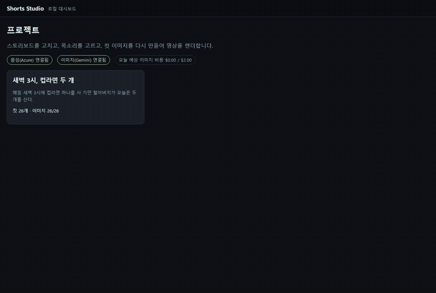

> 예제 작품 「새벽 3시, 컵라면 두 개」(26컷, 약 91초)는 이 파이프라인으로 만들었습니다. 영상 파일은 저장소에 넣지 않았습니다.
> 이미지는 Gemini, 음성은 Azure Speech로 생성한 AI 생성물이며 영상에는 "AI 생성" 표시를 넣을 수 있습니다.

## 무엇을 풀었나
"AI로 만든 티가 나는 영상"을 줄이는 쪽에 시간을 썼습니다. 문제를 눈으로 발견하고, 고치고, 숫자로 확인하는 순서였습니다.

| 문제 | 해결 | 확인 |
|---|---|---|
| 컷마다 인물 얼굴이 달라짐 | 기준 이미지를 요청마다 첨부, OpenCV(YuNet+SFace)로 얼굴 일치 검사 | 정면 컷 8개 일치(0.44~0.86), 옆·뒷모습은 보수적으로 "확인 필요" 표시 |
| 화면이 흔들려 보임 | PIL 서브픽셀 카메라 + 위상 상관 지표로 흔들림 측정 | `scripts/measure_shake.py` |
| 자막이 어색하게 끊김, 문장 끝 마침표 | 한국어 어절 단위 균형 분할, 수사·관형어 뒤 끊김 금지 | 단위 테스트 + 실제 렌더 프레임 |
| 할아버지 목소리가 "그냥 낮은 목소리" | 목소리 카탈로그와 추천(음높이 실측), 내레이션 모드 | 한계도 화면에 표시 |
| 유료 API 비용 폭주 | 사용자별 일일 한도·월 예산, 예약 후 환불 원장(SQLite) | 스레드·프로세스 동시 요청에서도 한도 초과 없음을 테스트 |
| 스토리보드를 직접 써야 시작할 수 있음 | 한 줄 프롬프트 → Gemini가 구조화 JSON으로 스토리보드 작성 → 카메라·화자별 목소리·강조어 보정과 입력·출력 검수 → 빈 컷 이미지 일괄 생성(등장인물이 처음 나온 컷이 기준 이미지) | 단위·브라우저 테스트, 실제 모델 1회 호출로 확인(8컷, 14초). 이미지 일괄 생성은 가짜 제공자로만 검증했고 실제 호출은 아직 해 보지 않음 |
| 오픈소스를 잘못 고를 위험 | 코드가 아니라 **모델 가중치** 라이선스까지 확인한 결정 기록 | [docs/open-source-decisions.md](docs/open-source-decisions.md) |

## 구조
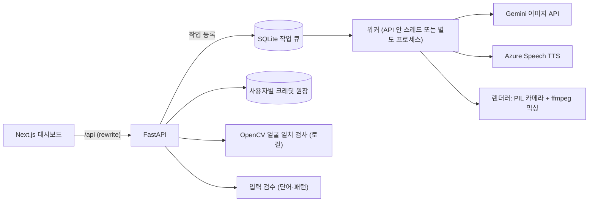
설계 문서: [docs/mvp-design.md](docs/mvp-design.md), 단계별 계획과 결과: [docs/phase1-plan.md](docs/phase1-plan.md).

## 검증 방식
- 단위 테스트 254개, 브라우저(Playwright) 테스트 20개(공개 데모용 9개 별도), `ruff` 통과.
- **테스트가 정말 잡아내는지 확인**하려고 코드를 일부러 망가뜨리는 변형 검증을 했습니다. 이 과정에서 약한 테스트 여러 개
  (항상 통과하던 테스트, 다른 요소에 맞아 통과하던 단언)를 찾아 고쳤고, 그 기록은 [open-source-decisions.md](docs/open-source-decisions.md)에,
  단계별 변형 검증 결과는 [phase1-plan.md](docs/phase1-plan.md)에 남겼습니다.
- 한계도 그대로 기록했습니다: 실제 Supabase 로그인과 결제는 만들지 않았고(범위 밖), 입력 검수는 단어·패턴 수준이며,
  노년 음색은 근사치이고, 큐의 동시 claim 락은 테스트로 증명하지 못했습니다.

## 화면
랜딩 페이지는 three.js로 만든 배경(예제 영상의 컷이 늘어선 복도를 카메라가 지나갑니다)과 GSAP 스크롤 연출입니다. 모션을 줄이는 설정에서는 고정·카메라 이동 없이 목록으로 읽힙니다.

| | |
|---|---|
| 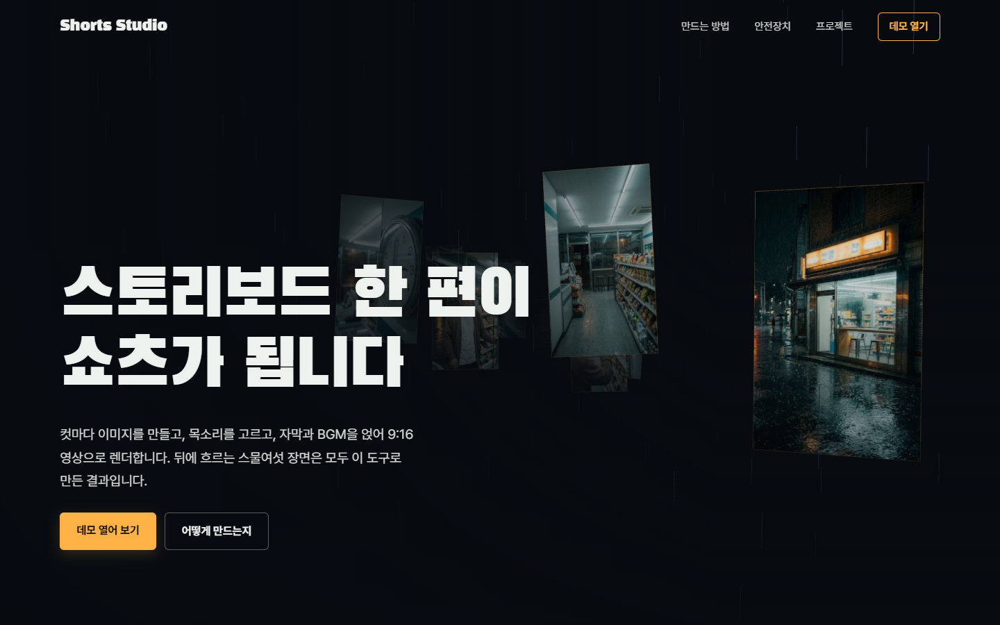 | 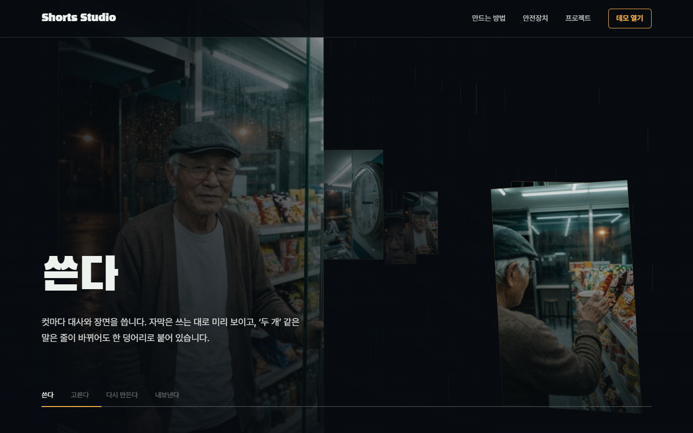 |
| 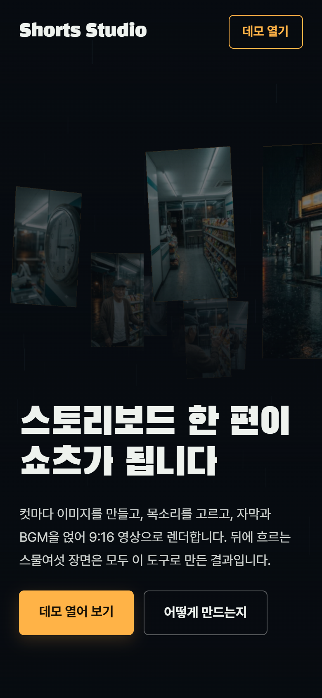 | 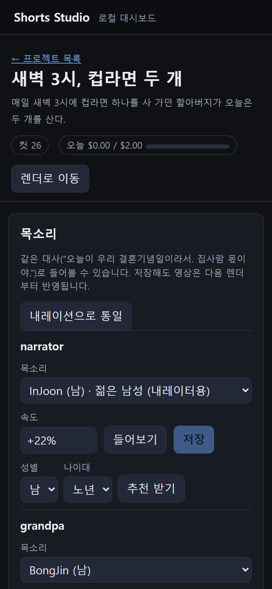 |
| 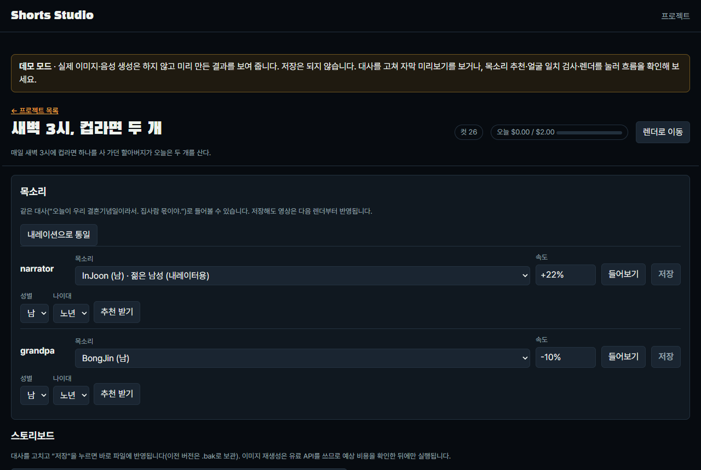 | 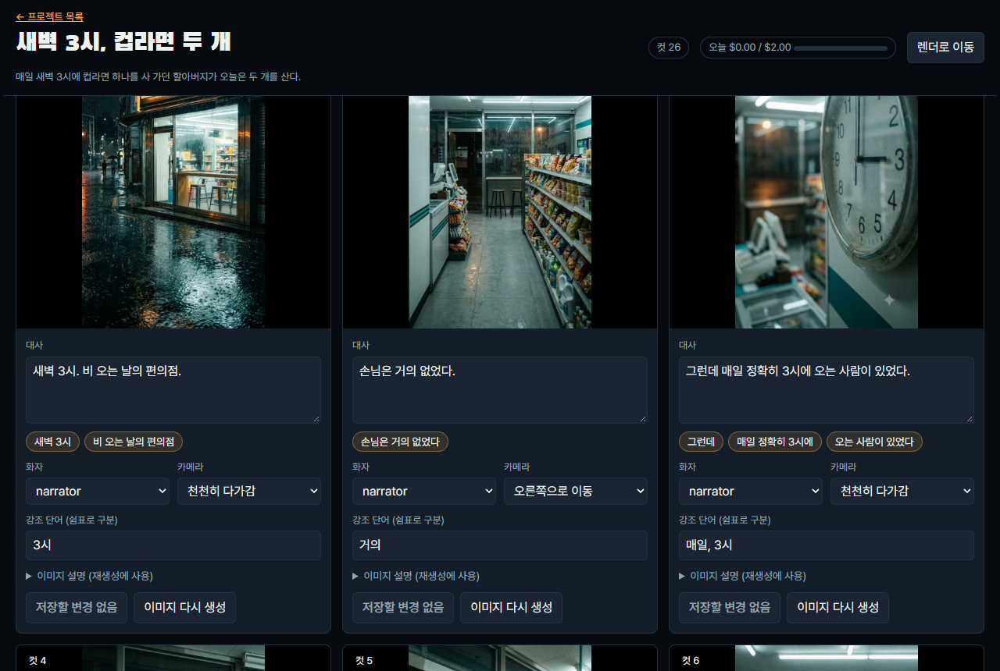 |
| 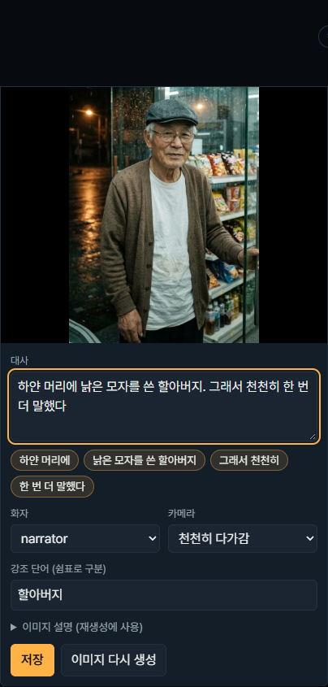 | 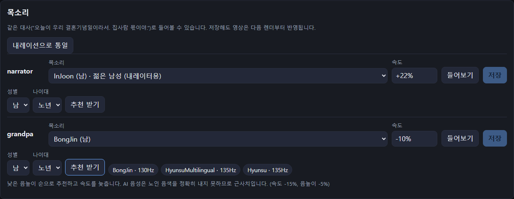 |
| 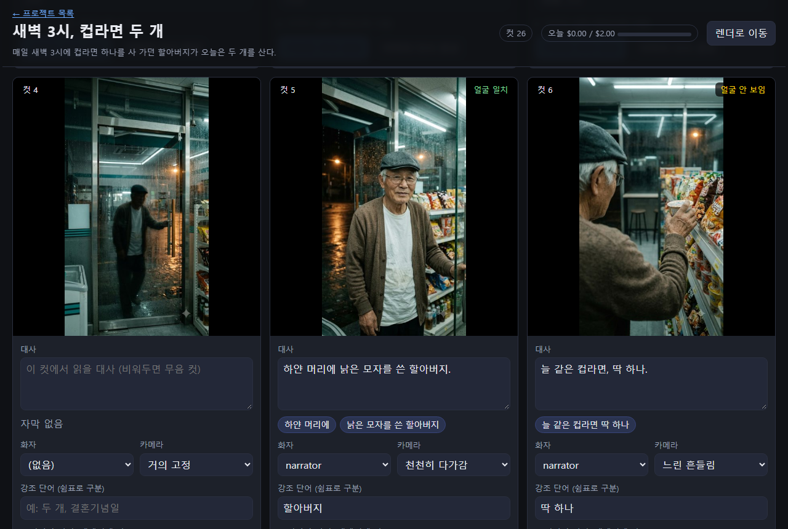 | 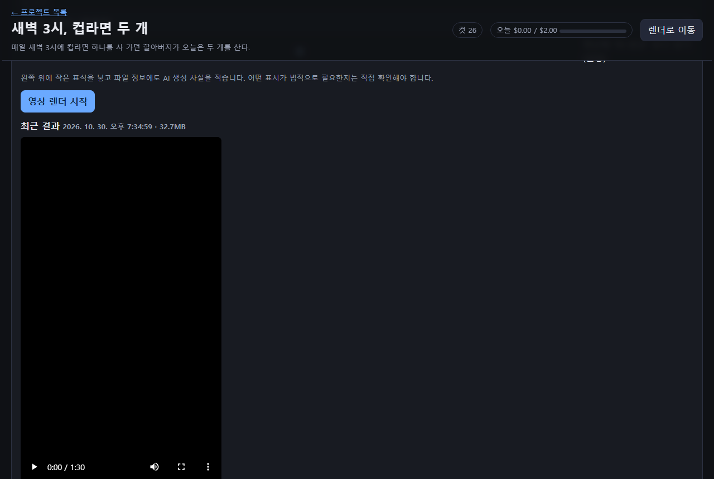 |

아래부터는 사용법과 개발 메모입니다. (Phase 0: prototype → provider-based library and CLI.)

## Layout
```
src/shorts_studio/
  models.py            Storyboard / Shot / VoiceSpec (JSON schema of examples/*/storyboard.json)
  providers/           ImageProvider, VoiceProvider interfaces + Azure voice, Gemini image, directory source
  render/              camera, subtitles, bgm (procedural score), mix, renderer
  qa.py                deterministic storyboard checks
  cli.py               render | lint | voice-samples | image-consistency
examples/convenience-store/storyboard.json
docs/                  MVP design, open-source decisions
scripts/               measure_shake.py (jitter metric), compare_renders.py (regression check)
tests/                 unittest, no extra dependencies
```

## Setup
Python 3.11+, `pip install pillow numpy imageio-ffmpeg` (ffmpeg comes bundled with imageio-ffmpeg).
Run from the repo root with `PYTHONPATH=src`, or `pip install -e .`.

Environment variables (never commit keys):
- `AZURE_SPEECH_KEY`, `AZURE_SPEECH_REGION` — voices
- `GEMINI_API_KEY` — image-consistency harness (paid: image generation has no free tier)
- `SHORTS_FONT` — optional subtitle font path

## Use
```bash
python -m shorts_studio lint examples/convenience-store/storyboard.json --images <folder with cutNN.png>
python -m shorts_studio render examples/convenience-store/storyboard.json --images <folder> --out output/short.mp4
python -m shorts_studio render ... --only 5,14,16          # preview a few shots
python -m shorts_studio voice-samples --out output/voice_samples
python -m shorts_studio bgm-sample --seconds 30 --out output/bgm/bgm.wav   # audition the 3 score styles
python -m shorts_studio render ... --ai-label                                   # burn in an "AI 생성" badge + mp4 metadata
python -m shorts_studio render ... --bgm-style warm_major                    # night_piano (default) / warm_major / tense_low
python -m shorts_studio image-consistency examples/convenience-store/storyboard.json \
    --character grandpa --shots 5,16,21 --model <gemini-image-model-id> [--dry-run]
python -m shorts_studio generate examples/convenience-store/storyboard.json --images <folder> \
    --model <gemini-image-model-id> --char-ref grandpa=<folder>/cut05.png --char-ref alba=<folder>/cut13.png \
    [--shot-ref 24=<folder>/cut26.png] [--shots 22,23] [--replace 1] [--dry-run]   # make missing shots with reference images
python -m unittest discover -s tests
```
`generate` writes `cutNN.png` plus `cutNN.meta.json` (model, prompt, references) and keeps a replaced image as `cutNN_prev.png`.
Shots without an image are skipped, so the renderer works on a partial set.

## Local dashboard (FastAPI + Next.js)
A single-user web UI over the same library: edit the storyboard (dialogue, camera, highlight words, live subtitle
preview), audition and pick voices, regenerate one shot's image (with a cost confirmation), render, and play/download.
```bash
python -m venv .venv && .venv/Scripts/python -m pip install -e ".[api,dev]"      # backend deps
cd frontend && npm install && cd ..                                              # frontend deps

# once per project: copy a storyboard + images into the dashboard data folder (.data/, git-ignored)
python -m shorts_studio import-project convenience-store examples/convenience-store/storyboard.json \
    --images <folder with cutNN.png> --char-ref grandpa=cut05.png --char-ref alba=cut13.png

python -m shorts_studio serve --data .data --port 8765          # API, localhost only
npm --prefix frontend run dev -- -p 3010                        # UI -> http://localhost:3010
```
- Keys come from the environment of the **API process** (`AZURE_SPEECH_KEY/REGION`, `GEMINI_API_KEY`) and are never
  sent to the browser; the UI only shows whether they are set.
- Paid actions (image regeneration) need an explicit confirmation and stop at an estimated daily cap
  per user (`SHORTS_DAILY_CAP_USD`, default 2.00; unit price estimate `SHORTS_IMAGE_PRICE_USD`, default 0.067), plus an
  optional budget shared by everyone (`SHORTS_MONTHLY_CAP_USD`, default 0 = off). The ledger is `.data/ledger.sqlite3`
  (an old `spend.jsonl` is imported once) and holds estimates, not invoices. A reservation is checked and recorded in one
  transaction, so quick clicks or several workers cannot overshoot a cap, and it is refunded at most once.
- Port 8000 is reserved by Windows on some machines (that is why the default is 8765). The frontend proxies `/api/*` to
  `API_ORIGIN` (default `http://127.0.0.1:8765`).
- Jobs (image regeneration, render) are rows in `<data>/jobs.sqlite3`, so they survive restarts. By default two worker
  threads run inside the API process. To run them elsewhere: `serve --no-worker` plus one or more
  `python -m shorts_studio worker --data .data` in other terminals (same folder). A job whose worker died (no heartbeat
  for 60 s) is marked failed and, for an image job, its reserved spend is refunded.
- Edits are written to `storyboard.json` atomically and the previous version is kept as `storyboard.json.bak`.
- Tests: `.venv/Scripts/python -m unittest discover -s tests`; frontend: `cd frontend && npx tsc --noEmit && npx next build`.

## Hosted mode: login (backend)
The dashboard runs as one fixed local user by default (safe only on localhost). With login tokens configured, every
route except `/api/health` needs `Authorization: Bearer <Supabase access token>` and each user sees only their own data.
```bash
pip install -e ".[api,auth]"
set SUPABASE_URL=https://<project>.supabase.co          # public keys (ES256/RS256) are fetched from <url>/auth/v1/.well-known/jwks.json
set SUPABASE_JWT_SECRET=...                              # only for projects that still sign with the shared HS256 secret
set SHORTS_ALLOWED_HOSTS=studio.example.com              # the site's public host name(s)
```
Expiry, audience (`authenticated`) and issuer are checked, and the accepted algorithms are fixed by the mode you configure.
The browser login screen is not built yet, so only API clients can sign in for now.

## License
Source code: [MIT](LICENSE). Third-party files and dependencies keep their own licenses, and the AI-generated media in `demo/` and
`docs/media/` is not licensed for reuse: see [NOTICE.md](NOTICE.md).

## Continuous integration
`.github/workflows/ci.yml` runs on every push to `main` and every pull request: lint + unit tests (with the face models downloaded and
sha256-checked), type check + both browser suites (fake providers, and the real demo bundle), and a build of the demo image that is
started and probed. The same steps were reproduced locally in Linux containers (Python 3.12 and Node 22) before the first push.

## Public demo (no keys, no cost)
`SHORTS_DEMO=1` turns the dashboard into a safe public demo: no key is read and no paid service is ever called. It serves a
pre-built bundle in `demo/` (540 px images, one finished video, pre-made voice samples, a pre-computed face check; about 6 MB,
built by `scripts/build_demo_assets.py`), replays image regeneration and rendering as a progress animation, refuses to save
edits, and rate-limits every changing request per client. Typing a line still gives the live subtitle preview and the voice
recommendation and face-check buttons work, so a visitor can follow the whole flow.
```bash
SHORTS_DEMO=1 SHORTS_DEMO_DIR=demo SHORTS_DATA=/tmp/shorts-demo python -m shorts_studio serve --data /tmp/shorts-demo --port 8765
npm --prefix frontend run dev -- -p 3010                     # then open http://localhost:3010

docker build -t shorts-studio-demo . && docker run --rm -p 3000:3000 shorts-studio-demo      # one container, API + UI
cd frontend && npm run test:e2e:demo                          # browser tests against the real bundle
```
Behind reverse proxies that append the visitor's address to `X-Forwarded-For`, set `SHORTS_PROXY_HOPS` to how many of them you trust
(the visitor is that many entries from the right; everything further left is ignored); with the default `0` all visitors share the
proxy's budget. Changing requests have three budgets per minute: per visitor (`SHORTS_DEMO_RATE`, default 30), ten times that for the
cheap live subtitle preview, and twenty times it for everyone together, which still caps the total if visitors cannot be told apart. The image (`Dockerfile`) installs only fastapi, uvicorn, pillow and numpy: the demo
never renders, so ffmpeg and OpenCV are left out.

**Live demo:** https://shorts-studio-demo-280103166969.asia-northeast3.run.app (Google Cloud Run, Seoul; scales to zero, so the first visit after idle takes a few seconds).

Step-by-step deployment to Google Cloud Run (scale-to-zero, cost caps, how to check the visitor rate limit): [docs/DEPLOY.md](docs/DEPLOY.md).

## Input screening
`lint`, the dashboard's check list and the API run a first-line screen over every title, description, line and scene
(`src/shorts_studio/safety.py`). Clear violations (sexual content, minors in sexual content, suicide/self-harm methods,
weapon or drug recipes, deepfakes/fraud) are errors: image regeneration and rendering are refused with an explanation and
nothing is reserved or sent to a provider. Graphic violence only warns. Drafts can still be saved. It is a transparent word
list, not moderation: it cannot read intent, hate speech or real people's names, and it can be phrased around. Review the
lists before opening the service to others.

## Quality tooling
```bash
.venv/Scripts/python -m pip install -e ".[api,vision,dev]"      # + opencv-python-headless, ruff
.venv/Scripts/ruff check .                                       # lint (config in pyproject.toml)
.venv/Scripts/python -m unittest discover -s tests               # 213 tests

python -m shorts_studio fetch-models                             # YuNet + SFace (~37 MB, sha256-checked, not in git)
python -m shorts_studio face-check examples/convenience-store/storyboard.json --images <folder>     --reference grandpa=<folder>/cut05.png --reference alba=<folder>/cut13.png

cd frontend && npx playwright install chromium && npm run test:e2e   # 16 browser tests, fake providers, no real keys
```
`face-check` assigns every face in a shot to the closest reference character and flags faces that match nobody
(`drift?`) or are too small to judge (`small`). It is reliable for frontal faces; profiles, overhead and back views
often score low, so use it to pick shots for a human to look at, not to reject them automatically.
The E2E tests run against a private API (`tests/e2e_server.py`) and a separate build folder (`.next-e2e`), so they never
touch your data, real keys, or a dev server you have open.

## Fonts
Subtitles need a Korean bold font. Resolution order: `--font`, `SHORTS_FONT`, `assets/fonts/Pretendard*Bold*` or
`NotoSansKR*Bold*`, then Windows Malgun Gothic (development fallback only — not redistributable in a hosted service).
Both Pretendard and Noto Sans KR are SIL OFL fonts.

## Status
See [docs/mvp-design.md](docs/mvp-design.md) section 11.
- Done: provider-based library + CLI, output identical to the prototype (pixel diff 0.0000 on sampled frames),
  bundled open font (Pretendard Bold, SIL OFL 1.1; licence text in `assets/fonts/Pretendard-LICENSE.txt`).
- Done: real-API reference-image consistency test (see "Phase 0 results" in docs/mvp-design.md).
- Next: multi-character shots, an objective face-similarity check, and Phase 1 (API + worker).


## Security deployment notes

See [thumbnail isolation and shared speech budget configuration](docs/SECURITY_REMEDIATION.md) before enabling paid speech or running standalone workers.
